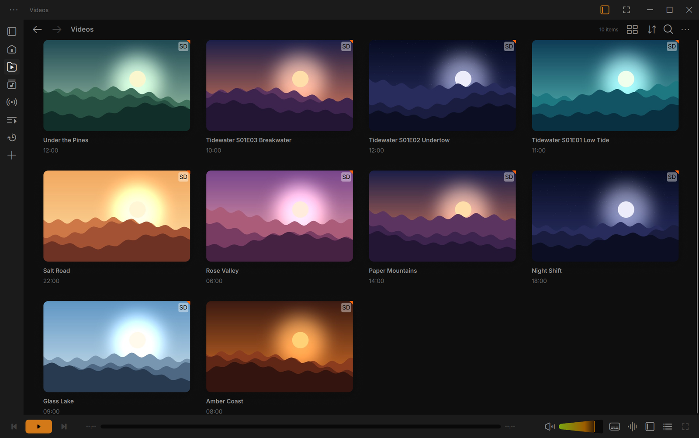
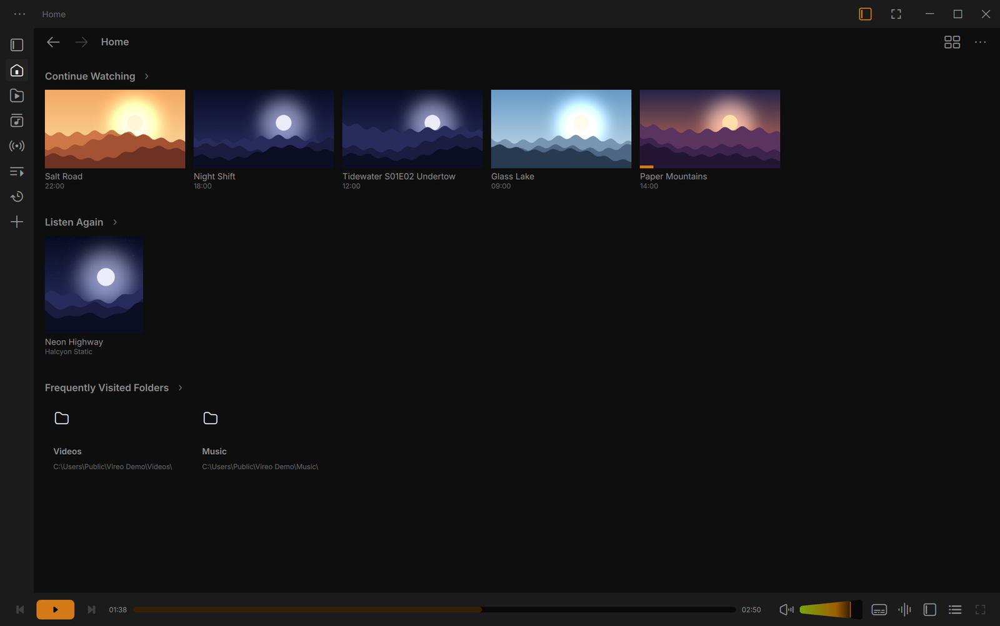
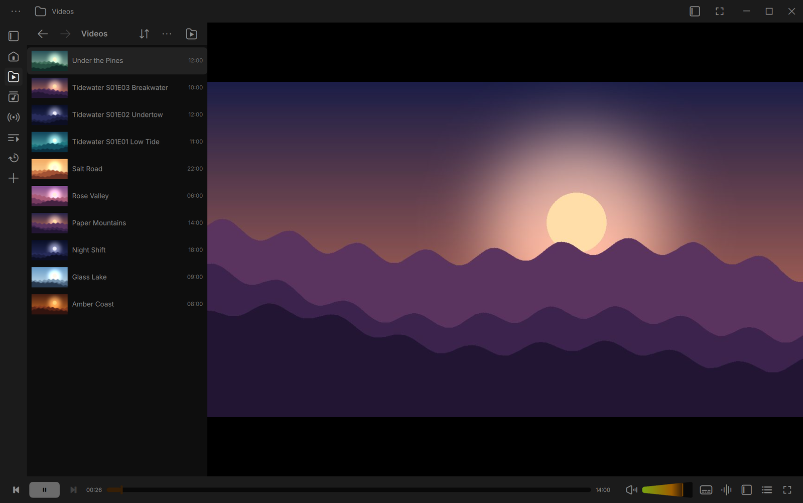
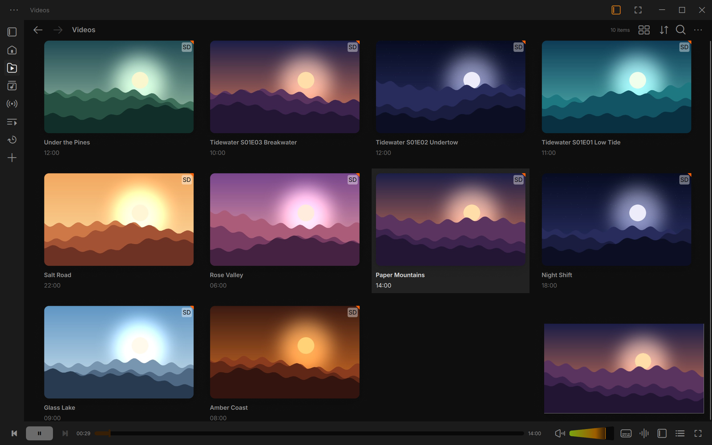
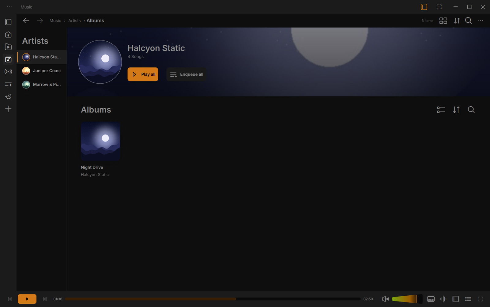
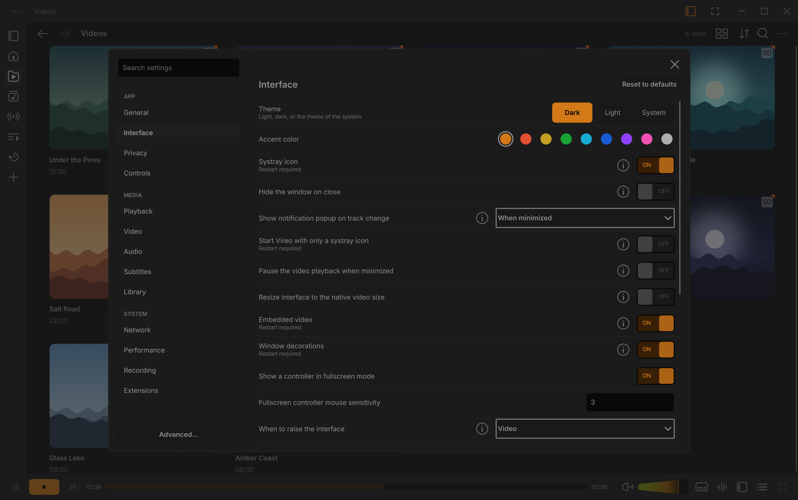
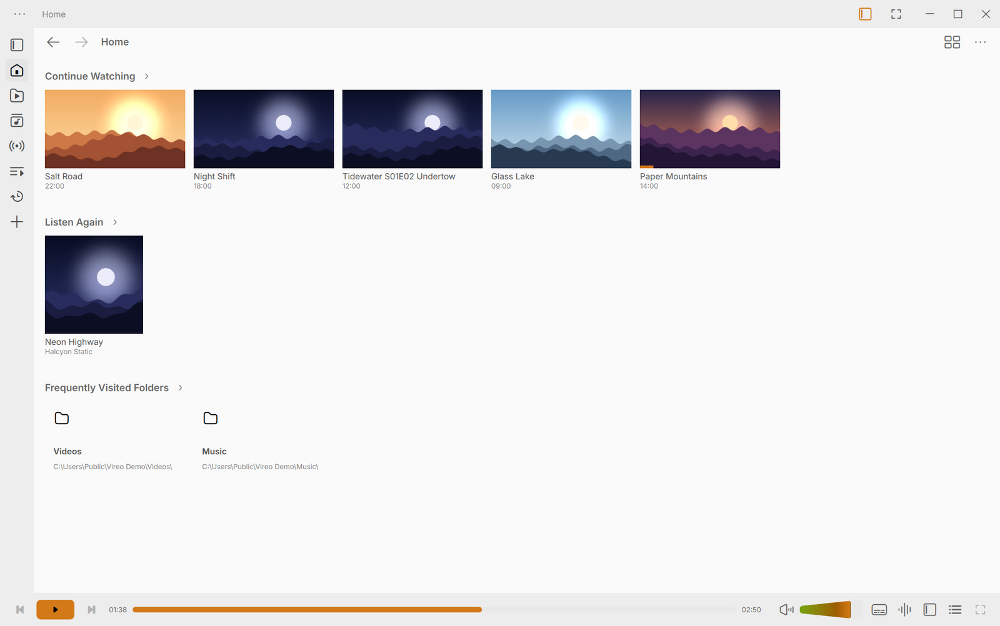
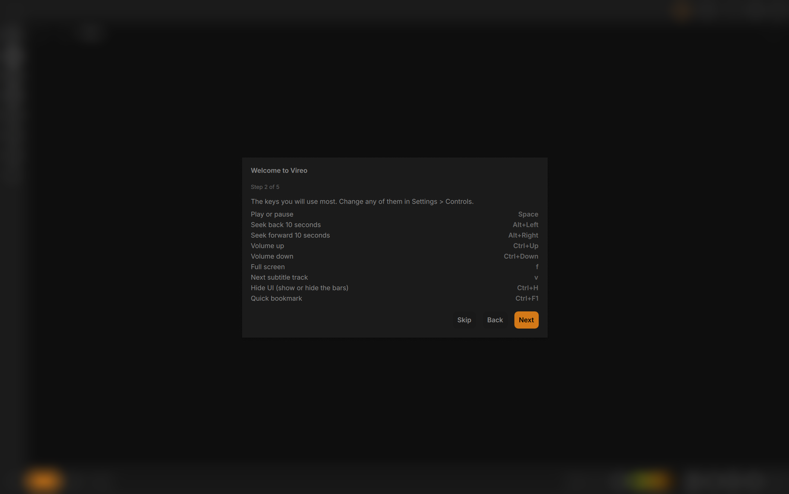
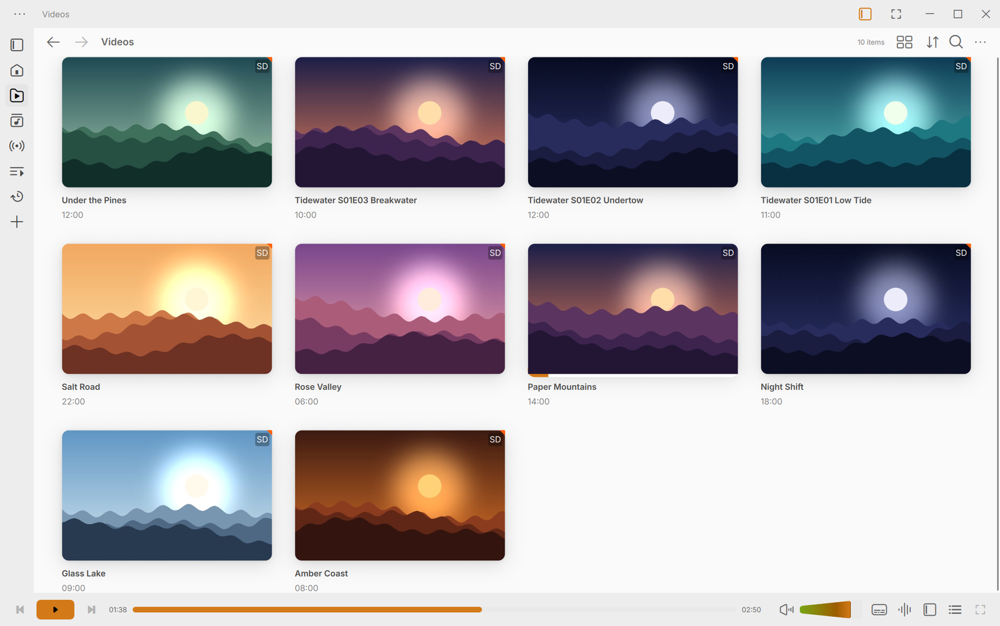

<div align="center">


# Vireo

**The media player that plays everything, with a design that feels like 2026.**

Vireo is a free, open-source media player for Windows 10 and 11, built on the engine of
[VLC media player](https://www.videolan.org/vlc/). Same codecs. Same "it just plays".
A completely new interface.

[](https://github.com/ishaq-bhojani/vlc-player-upgraded-UI/releases)
[](https://github.com/ishaq-bhojani/vlc-player-upgraded-UI/releases)
[](COPYING)

[**Download for Windows**](https://github.com/ishaq-bhojani/vlc-player-upgraded-UI/releases) ·
[Screenshots](#a-closer-look) ·
[45-second tour (video)](docs/screenshots/vireo-demo.mp4) ·
[Report a problem](https://github.com/ishaq-bhojani/vlc-player-upgraded-UI/issues)

<br>



</div>

## Why Vireo?

VLC plays almost any file you throw at it, but its interface has barely changed in twenty
years. Vireo keeps the engine you trust and redesigns everything you see and touch.

- **A library that makes sense.** Your videos and music, with real thumbnails, grid, list
  and details views, search, and an address bar you can click to go back up.
- **Pick up where you left off.** *Continue Watching* and *Listen Again* are on the home
  page, and you can sort by *Unwatched first*.
- **A player that stays out of the way.** A clean control bar, a big seek bar (a waveform
  for music), and bars that hide in fullscreen. Press **Ctrl+H** to hide everything.
- **Settings in plain language.** 13 short pages instead of a wall of options. Every VLC
  preference is still there under *Advanced* if you need it.
- **Light, dark, and your colour.** Three themes and nine accent colours.
- **Private by design.** No accounts, no telemetry, no ads. Vireo asks before it looks up
  cover art online, and the update check is one switch away.
- **Safe next to VLC.** Vireo has its own folder, its own settings and its own updates. It
  never touches an existing VLC installation.

## A closer look

<table>
  <tr>
    <td width="50%"></td>
    <td width="50%"></td>
  </tr>
  <tr>
    <td align="center"><b>Home.</b> Continue Watching, Listen Again and your frequent folders.</td>
    <td align="center"><b>Watch and browse.</b> The library stays beside the video.</td>
  </tr>
  <tr>
    <td></td>
    <td></td>
  </tr>
  <tr>
    <td align="center"><b>Mini player.</b> Keep watching while you look for the next thing.</td>
    <td align="center"><b>Music.</b> Artists, albums and tracks, with cover art.</td>
  </tr>
  <tr>
    <td></td>
    <td></td>
  </tr>
  <tr>
    <td align="center"><b>Settings.</b> Short pages, plain words, a search box.</td>
    <td align="center"><b>Light theme.</b> Or dark, or follow Windows.</td>
  </tr>
  <tr>
    <td></td>
    <td></td>
  </tr>
  <tr>
    <td align="center"><b>A one-minute introduction</b> sets the theme, privacy and folders.</td>
    <td align="center"><b>Your library, your way.</b></td>
  </tr>
</table>

<sub>The videos and music in these screenshots were generated for the demo.</sub>

## Get it

1. Go to the [Releases page](https://github.com/ishaq-bhojani/vlc-player-upgraded-UI/releases)
   and open the newest build.
2. Download one of these:
   - **`vireo-<version>-win64.exe`**: the installer (about 60 MB).
   - **`vireo-<version>-win64-portable.zip`**: no installation. Unzip it anywhere, even
     on a USB stick, and run `vireo.exe`. Your settings stay in that folder.
3. Windows SmartScreen may say it "protected your PC", because the builds are not
   code-signed yet. Click **More info**, then **Run anyway**.

You can also check the download against `SHA256SUMS` from the same release. The installer
is GPG-signed (`.asc`) with [this public key](docs/redesign/reborn-update-public.asc). See the
[code signing policy](CODE_SIGNING.md).

> [!NOTE]
> Vireo is in **early testing**. The builds are release candidates: they work well
> day to day, but you may find rough edges. Please
> [report them](https://github.com/ishaq-bhojani/vlc-player-upgraded-UI/issues); every
> report helps.

## Questions

**Does it play the same files as VLC?**
Yes. The playback engine, codecs and plugins are VLC's, so it plays the files, discs,
streams and subtitles that VLC 4 plays.

**Will it mess up my VLC?**
No. Vireo installs into its own folder, keeps its settings in `%APPDATA%\vireo` and has its
own update channel. You can keep both players installed.

**Is it really free?**
Yes, with no ads, no accounts and no tracking. Vireo is open source under the GPL, like VLC.
See the [privacy policy](PRIVACY.md) for the few times Vireo connects to the internet.

**Is Vireo made by VideoLAN?**
No. Vireo is an independent project built on VLC's open-source code. It is **not
affiliated with or endorsed by VideoLAN**, so please send Vireo problems
[here](https://github.com/ishaq-bhojani/vlc-player-upgraded-UI/issues) and not to them.

**Mac or Linux?**
Not yet. Vireo is Windows-only for now.

## Handy shortcuts

| Keys | Action |
|---|---|
| Space | Play or pause |
| Alt+← / Alt+→ | Seek back or forward 10 seconds |
| Ctrl+↑ / Ctrl+↓ | Volume up or down |
| F | Fullscreen (Esc to leave) |
| V | Next subtitle track |
| Ctrl+H | Hide or show the bars |

Vireo briefly shows the name of each shortcut you press. *Menu › Keyboard shortcuts* lists
them all, and you can change any of them.

## Build from source

Vireo is cross-compiled in VideoLAN's Docker image. On Windows you need Docker Desktop and
Git Bash:

```bash
bash extras/redesign/dev-build.sh              # builds build-win64/win64-meson/vlc-win64/vireo.exe
bash extras/redesign/dev-build.sh --installer  # also the installer
bash extras/redesign/linux-tests.sh            # the Qt and QML tests
```

See [docs/redesign/building.md](docs/redesign/building.md) and
[docs/redesign/testing.md](docs/redesign/testing.md). The repository is a fork of VLC:
Vireo's code lives in `modules/gui/qt/redesign/`, and its few changes to VLC's own files are
listed in [docs/redesign/upstream-touchpoints.md](docs/redesign/upstream-touchpoints.md).
Security and stability fixes from upstream VLC are cherry-picked into the fork.

## Contributing

Bug reports, ideas and pull requests are welcome. Please open an
[issue](https://github.com/ishaq-bhojani/vlc-player-upgraded-UI/issues) first for anything
large, so we can agree on the approach. If you like Vireo, a ⭐ on this repository helps
other people find it.

## License and credits

Vireo is released under the **GNU GPL, version 2 or later** ([COPYING](COPYING)), like VLC.
libVLC and libvlccore are under the LGPL, version 2.1 or later ([COPYING.LIB](COPYING.LIB)).

Vireo exists thanks to the [VideoLAN](https://www.videolan.org/) project and the many
volunteers who build VLC media player ([AUTHORS](AUTHORS), [THANKS](THANKS)). "VLC" and
"VideoLAN" are trademarks of their owners. The interface follows the Figma community file
*VLC Redesign*; further credits are in
[docs/redesign/THIRD-PARTY.md](docs/redesign/THIRD-PARTY.md).
